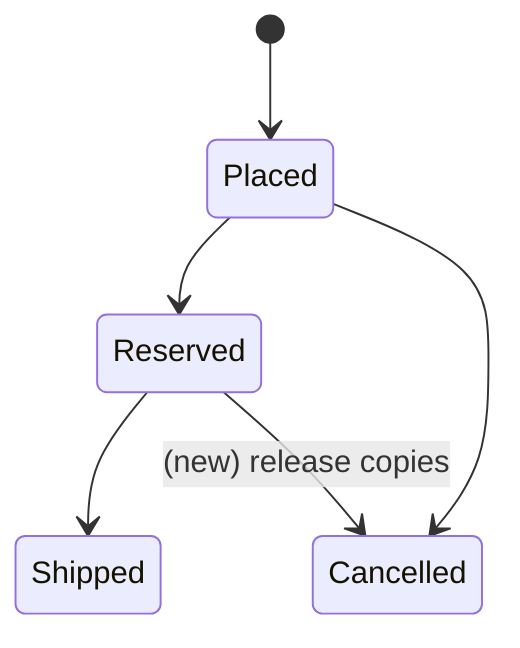
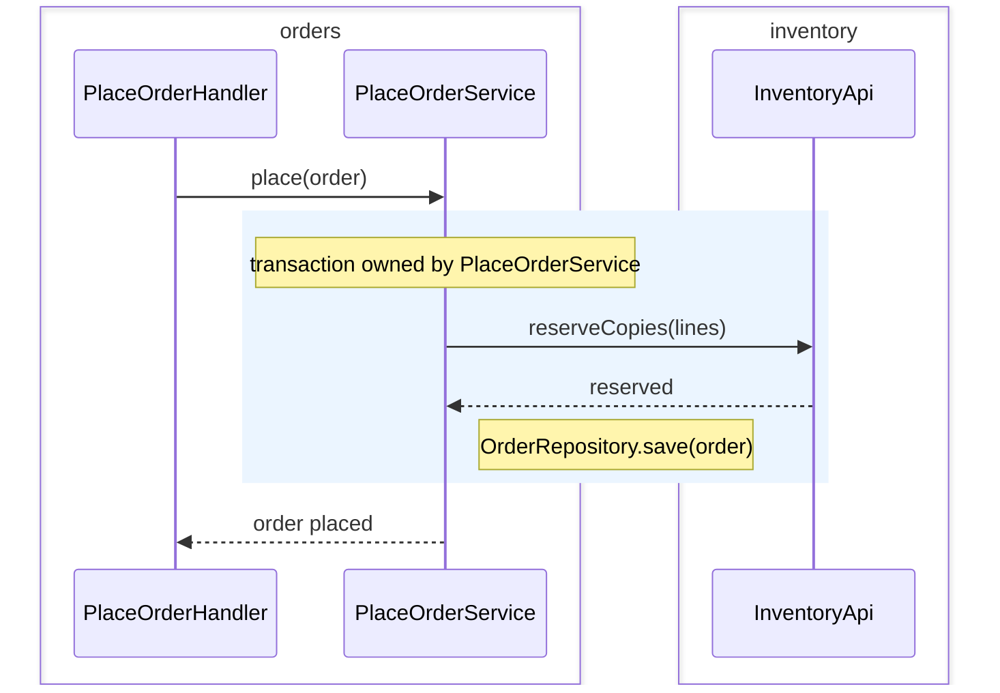

# <Title: the change in one phrase>

> **Template.** Delete this note when filling in. Write the headings in `project.languages.human`; `DT-nn` and `NOT VERIFIED` stay literal.
>
> Nine sections are required reading and publish expanded. Seven are optional reading and carry `{collapsed}`; the docs adapter turns the mark into the tool's collapse syntax, and when the adapter cannot collapse, the section stays visible and the heading gets ` (optional reading)` appended. Optional reading is not optional writing: write every section.
>
> No estimates: no days, no points, no phases with an owner, no phases by layer.

- Authors: <names>
- Date: <YYYY-MM-DD>
- Scope: <modules and boundaries this document covers>
- Parent document: <link, only when this document was split from another>

## Context

<What exists today and why this change comes now. Cite code by `file:line`.>

## Problem

<The observable failure or gap, in one paragraph.>

## V1 scope

<What ships in V1. The delivery boundary is itself a decision: state it here.>

## Out of scope and future {collapsed}

<What this document leaves out, one line each. A boundary handled by another document gets one line with a link to it.>

## Solution and contracts

<The proposed design. Name every contract that changes: endpoint, event, table, public API.>

<Table and column names match the schema read through the `domain-context` skill, or carry `NOT VERIFIED` next to the claim.>

## Technical decisions

### DT-01 — <the decision in one sentence>

- **Decided:** <the choice, in one or two lines>
- **Consequence:** <what this forces or rules out>
- **Verifiable in:** <`file:line`, or `new` when no code applies yet>

#### Deliberation DT-01 {collapsed}

**Context:** <the forces behind the choice>

**Options:**

- (a) <option>
- (b) <option>

**Why (b) lost:** <the reason the discarded option was discarded; never a pointer to somewhere else>

## Domain invariants and transaction boundaries

| Invariant | Given / When / Then | Transaction boundary | Compensation |
|---|---|---|---|
| An order never reserves more copies than `inventory` holds | **Given** 1 copy in stock, **When** two orders reserve it at once, **Then** one succeeds and the other is refused | Reserve and order insert in one transaction owned by `orders` | Release the copies when the order is cancelled |

## State diagram

<Required when the design touches an entity listed in `domain.stateful_entities`; otherwise one line naming the entities checked.>

Legend: a transition without a mark exists today; `(new)` marks a transition this document proposes.

## Code flows {collapsed}

This section projects the `DT-nn` onto code components through the repository's patterns. It does not decide. A component name marked `new` is a suggestion; its type, module and async boundary bind. A choice revealed here that no rule forces becomes a `DT-nn`.

### Components

New (`new`): <count>

- `<ComponentName>`: module `<module>`, type `<a layer from architecture.layers>`, <responsibility>; why: <DT-nn, rule, pattern or golden path>

Changes (`changes`): <count>

- `<ComponentName>`: module `<module>`, type `<layer>`, <responsibility>; where: `<file>`, <smallest path that identifies it>

Reused without change (`exists`): <count>

- `<ComponentName>`: module `<module>`, type `<layer>`, <responsibility>; where: `<file>`

### <Entry point> — <scenario>

A `###` per entry point: request, job or webhook. A sad path goes in an `alt` block or in its own `###`. One `box` per module. A lane is a listed component or an external actor; a pure domain service and a module's own repository become a `Note`.

## Security {collapsed}

<Authentication, authorization, sensitive data and what is logged.>

## Tests {collapsed}

<Which invariants become which test scenarios, and at which level.>

## Observability {collapsed}

<Logs, metrics and traces a person needs to tell the change works.>

## Rollback and flag {collapsed}

<How to undo the change in production, and the flag that gates it.>

## Risks

| Risk | Consequence | Mitigation |
|---|---|---|

## Candidate slicing {collapsed}

> **Draft.** This slicing is a draft. Do not copy it to the tracker. The authority for the cut is the `reconcile` skill plus the merge test of the `breakdown` skill.

| # | Artifact | Consequence | Unblocks |
|---|---|---|---|

## Open questions

- <Question, with what changes depending on the answer.>
